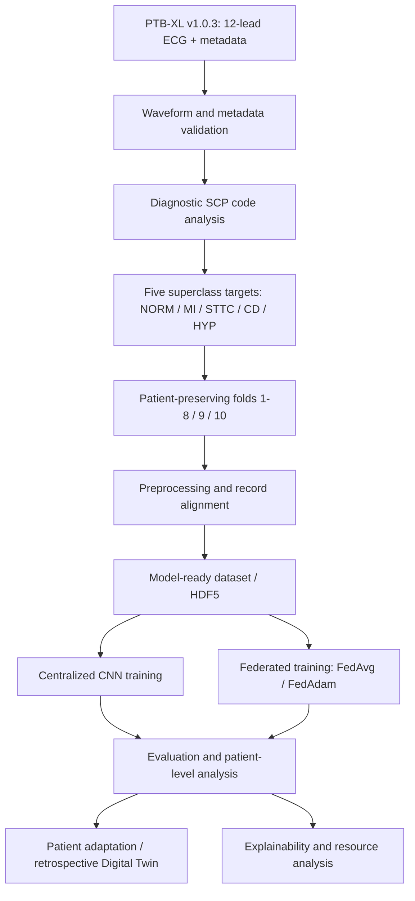

# Research workflow architecture

This diagram describes the intended study workflow and identifies which parts are currently represented by deposited source code. It is a conceptual pipeline, not proof that every stage is implemented in this repository.

## Deposited implementation coverage

The source code currently deposited covers waveform/metadata inspection, label mapping, patient/fold analysis, preprocessing, alignment, split validation, XAI input-file validation, full preprocessed dataset creation, and HDF5 preparation (Experiments 1A–5A).

The available files do not include centralized or federated model-training implementations, patient-level adaptation code, explanation generation (e.g. Integrated Gradients), or complete resource-profiling source. Those blocks are therefore shown as intended downstream workflow components, not as implemented repository modules.
