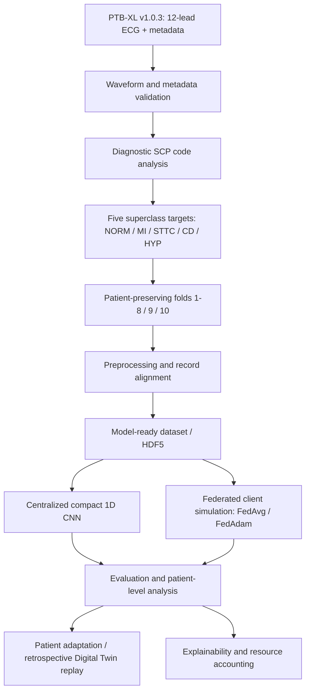

# Research workflow architecture

This diagram summarizes the manuscript workflow and distinguishes the deposited preparation scripts from the executable reference package. It is a conceptual workflow, not evidence of clinical deployment.

## Deposited implementation coverage

### PTB-XL preparation scripts

The repository contains 17 scripts across Experiments 1A–5A:
- 1A–1B: waveform and metadata validation;
- 2A–2C: diagnostic-code, superclass and patient/fold analysis;
- 3A–3C: preprocessing, label construction and dataset-loader checks;
- 4A–4H: model-ready preprocessing, label alignment, split integrity and XAI-input validation;
- 5A: HDF5 preparation.

Aggregate validation logs for Experiments 1A–3C are retained under `results/validation_logs/`.

### Executable reference package

The `src/efdt/` package contains:
- compact 1D CNN, centralized training and evaluation utilities;
- simulated patient-disjoint clients, IID/non-IID partitioning, FedAvg and FedAdam;
- patient support/query adaptation;
- retrospective computational patient-state replay;
- Integrated Gradients and perturbation/stability utilities;
- metric and analytical resource-accounting utilities;
- command-line entry points.

The package is executable and covered by synthetic-fixture unit tests. That does not mean every historical manuscript result is automatically regenerated by the reference package. The supplied historical federated artifacts are preserved separately under `results/federated/`. Centralized and detailed patient-level adaptation evidence should be deposited in the reserved result folders when the original run artifacts are available.

## Scientific scope

Federated clients are simulated, not real hospitals. The Digital Twin is retrospective state replay, not a live synchronized physiological twin. Explainability utilities do not establish causal or clinical validity. Analytical latency/energy assumptions are not physical-device measurements.
